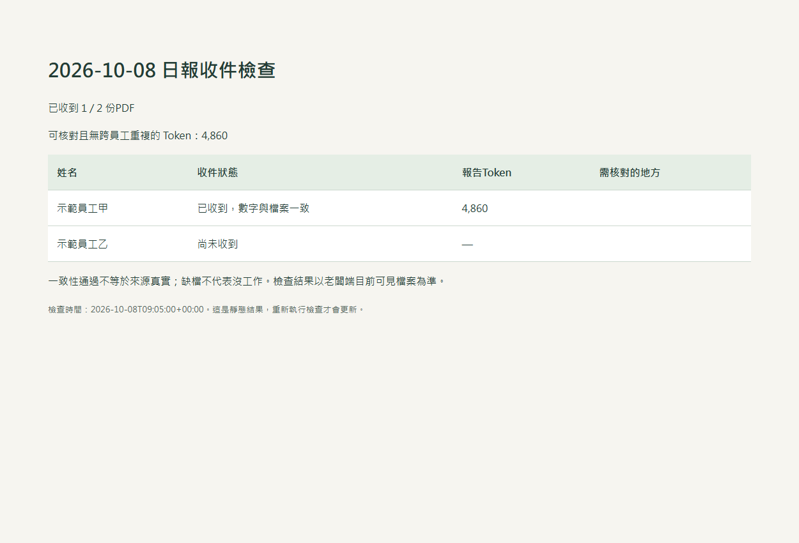

# 團隊用量帳本 · Team Token Ledger

**每天下班自動交一張 PDF；老闆先看誰交了，再核對 Token 數字。**

v0.2 改成「日期資料夾＋姓名日報」，不用架伺服器、不用配對檔。Windows 兩端已用合成資料實跑；公司跨電腦同步仍需試行。[驗證紀錄](docs/TEST_RESULTS.md)

產檔、補交、核對都是普通程式，**不呼叫模型、不需要 API key**。老闆另請 Claude 分析時，才使用 Claude 額度。



## 老闆先做三步

1. 準備 Google Drive／OneDrive 等公司同步資料夾，以及每行一個姓名的名單。
2. 在能操作本機的 Claude Code／Cowork 貼下面這段，提供資料夾的本機路徑和名單。
3. 先找兩名員工試交，老闆真的收到兩份後，再擴大人數。

> 請從這個專案安裝 v0.2 每日 PDF 日報的老闆端。先讀 boss/CLAUDE_HANDOFF.md 和 SETUP.md。我會提供共用資料夾位置及姓名名單。請實際執行收件檢查並驗證排程，用假資料試交，不要把私人報告上傳 GitHub，也不要建立定時呼叫 AI 的任務。

## 員工安裝一次，以後自動交

1. 先讓公司指定的同一資料夾同步到自己的電腦。
2. 把專案網址和下面這段交給能操作本機的 Codex／Claude Code。
3. 提供自己的姓名、同步資料夾位置及公司專案範圍；看一次試交結果。

> 請讀 employee/INSTALL.md，安裝 v0.2 每日 PDF 日報員工端。我會提供姓名及公司資料夾的本機路徑。先說明收集範圍，預設只分享專案名稱，不分享對話原文。完成後真觸發 Windows 排程並檢查日誌。不要裝舊版每五分鐘上傳器，也不要新增 AI 自動巡檢。

一般網頁聊天無法直接安裝電腦程式，需要本機工具權限。安裝需 Python 3.11+、PowerShell 7；缺少時依 [SETUP](SETUP.md) 處理，不能保證任何電腦只貼網址就全部完成。

## 每天的流程


17:00先交截至當時的報告。登入及每30分鐘檢查補交，晚間继续使用會更新同份，隔日補為整日版。關機／睡眠／登出時不能執行，恢復登入後補交仍有紀錄的日期。這些排程沒有模型呼叫。

```text
公司 AI 日報/
  2026-10-08/
    王小明.pdf
    陳小美.pdf
    .checks/       ← 程式核對用，一併同步
```

員工以姓名分類，不限四人；同名用「姓名（部門）」區分。老闆安裝目錄的 names.txt 一行一人，可自行增減。預設每天執行，尚無假勤整合，休假日缺件由老闆判斷。

## 基本檢查

| 檢查 | 用途 |
|---|---|
| 名單和PDF | 有沒有收到、缺誰 |
| 累計快照與明細 | 差值重算，避免歷史累計當今日用量 |
| 輸入＋輸出 | 必須與總數完全一致；快取不重複相加 |
| PDF指紋 | 改檔或核對檔不同步時提示 |
| 重複事件 | 同人去重，跨人重複暫不列入無爭議合計 |
| 老闆已看過的版本 | 明細減少、總量下降或裝置改變會持續提示 |
| 程式與設定 | 唯讀＋執行前指紋核對；改MD不會改算法 |

**這是基本一致性檢查。** 電腦主人仍能停排程、改來源或一起偽造PDF和JSON，不能把「算得攏」說成官方認證或絕對防弊。

## 範圍與限制

- 只統計本機留下的Codex紀錄；不讀登入憑證、不錄螢幕或鍵盤。預設只有專案名稱和數字，明確開啟才附工作請求短片段。這是工作線索，不表示已完成成果。
- 可限制公司專案路徑。雲端未落地、刪除的紀錄與格式改版可能漏算；共用帳號同步到別台的工作可能造成歸屬爭議，需兩台實測。
- Token不等於訂閱剩餘百分比、金額或績效。**目前沒有官方帳號總Token對帳來源**，只能核對已收到的本機紀錄。
- 透過Google Drive／OneDrive同步，不需同一內網；程式不代辦雲端登入、共用權限或同步設定。
- 員工顯示存入同步路徑，不代表老闆已收到。以老闆端實際可見檔案為準。
- 共用資料夾權限由公司設定，有權讀取的人就能看PDF。工具不自動實現員工互相隔離。
- 老闆收件HTML留在本機，不開網站服務。Windows已實測；macOS/Linux尚未提供v0.2排程安裝，不可沿用舊腳本冒充新版。

## 文件入口

[架構圖](docs/assets/architecture.png) · [PDF示範截圖](docs/assets/daily-pdf.png)。需要真正PDF可執行 `python scripts/demo_daily.py`，只產合成資料，不讀真實Codex紀錄。

[老闆落地六步](docs/OWNER_GUIDE.md) · [員工安裝](employee/INSTALL.md) · [老闆Claude交接](boss/CLAUDE_HANDOFF.md) · [技術安裝](SETUP.md) · [計算口徑](docs/MEASUREMENT.md) · [安全邊界](SECURITY.md) · [公司驗收](docs/ACCEPTANCE.md) · [測試紀錄](docs/TEST_RESULTS.md)

開發：`pip install -r daily/requirements.txt`，`python -m unittest discover -s tests -v`。
[舊版伺服器流程](docs/LEGACY_SERVER.md)僅保留相容，非本版預設。

MIT授權。GitHub只放程式與合成示例，私人日報、名單和原始紀錄不上傳。
