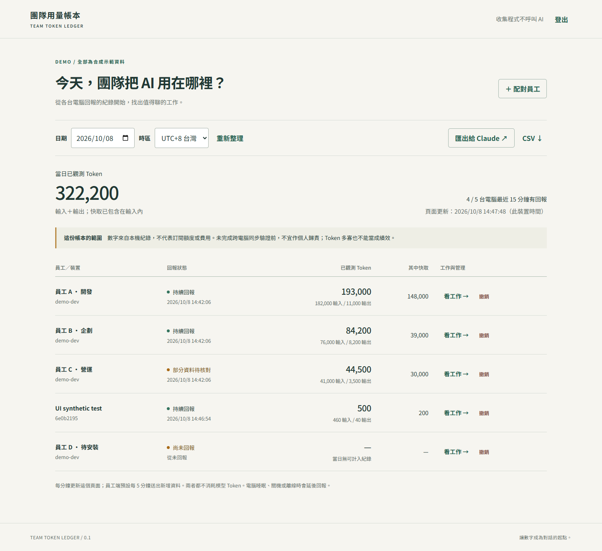

# 團隊用量帳本 · Team Token Ledger

**員工電腦自動回報 Codex 使用紀錄，老闆用網頁查看，需要時再交給 Claude 分析。**

收集、統計、定時上傳、網頁更新皆為一般程式，**不呼叫 AI，不需要 OpenAI／Anthropic API key**。只有你主動請 Claude 解讀日報時，才使用 Claude 的額度。

這是可自行架設的 **0.1.0 試行版**。它量測「本機紀錄觀測值」，不是官方帳單，也不是防竄改的員工稽核系統。正式按人歸責前，請完成 [兩台電腦驗收](docs/ACCEPTANCE.md)。



## 給員工：三步驟

1. 向老闆取得這個專案的 GitHub 網址，以及你自己的 `enrollment-….json` 配對檔。
2. 在能讀寫本機的 Codex／Claude Code 開新對話，貼這段：

   > 請安裝這個專案的員工端。先讀 employee/INSTALL.md，使用我提供的配對檔；預設只回報專案名稱，不分享工作原文。先告訴我會收集什麼，再完成安裝、實際觸發背景回報、確認狀態。不要把憑證或我的對話上傳 GitHub，也不要新增定時 AI 任務。

3. 提供配對檔的本機路徑；若要分享工作片段或限定公司專案，依安裝說明設定。安裝成功後，每 5 分鐘自動回報新增紀錄。

員工端從安裝時起算，**不回傳安裝前的歷史對話**。各台電腦配對一次；重新配對不能只換名字冒充另一人。

## 給老闆：三步驟

1. 把這個專案網址交給能操作本機的 Claude Code／Cowork，貼這段：

   > 請讀 boss/CLAUDE_HANDOFF.md，幫我建立團隊用量帳本。先在我的電腦完成本機驗收，再依員工是否同一網路安排連線。我要看用量、工作線索和缺件狀態；不要新增會定時呼叫 AI 的巡檢，也不要自動購買雲端服務。

2. Claude 按 [SETUP.md](SETUP.md) 啟動老闆端，帶你登入網頁，替每台員工電腦下載配對檔。**配對檔私下交付，管理金鑰只留給老闆。**
3. 員工安裝後，打開網頁查看；按「匯出給 Claude」，把 Markdown 日報交給自己的 Claude，請它提出有證據的建議。

只有一般 Claude 網頁聊天、沒有本機工具權限時，它可以讀報表與指導安裝，但不能直接替你操作電腦。GitHub Pages 只能放靜態網站，無法執行這個收件後端。

## 會看見什麼？

| 項目 | 說明 |
|---|---|
| 用量 | 按日的輸入／輸出 Token、快取子集、模型分布 |
| 工作 | 專案資料夾名稱；明確開啟才傳最近使用者請求的最多 180 字片段 |
| 回報狀態 | 最近回報、尚未安裝、回報中斷、待補傳、解析警示 |
| 歸屬爭議 | 不同裝置傳來相同事件時，兩邊暫時排除，不列入用量合計 |
| 老闆交接 | Markdown 日報與 CSV；不需要兩邊使用同一個 AI 品牌 |

## 動手前要知道的限制

- **一人一個帳號仍是建議做法。** OpenAI 的[帳號共用政策](https://help.openai.com/en/articles/10471989)說明個人帳號應由本人使用；本工具不改變平台的帳號規則，也不要求共用帳號。
- 共用帳號可能讓不同電腦收到同一份工作紀錄；配對只能確定「哪台電腦回報」，不能單靠它證明「誰發起工作」。請按驗收表測試。
- 本機沒有落地的雲端／網頁任務、已刪除紀錄、未知格式與未安裝電腦，都可能漏掉。**沒有資料不是沒有使用。**
- Token 不等於訂閱剩餘百分比、實際費用、工時或績效。沒有換算金額的功能。
- 網頁需要老闆端服務持續運作。員工睡眠／關機／斷線時不會即時回報，恢復後補傳仍保留的新增紀錄。
- 這個專案不收集螢幕、鍵盤、其他 App、完整對話或 Codex 登入憑證。文字遮罩只盡力處理常見格式，不能保證去除商業機密。

## 文件入口

- [員工安裝與移除](employee/INSTALL.md)
- [老闆給 Claude 的交接檔](boss/CLAUDE_HANDOFF.md)
- [架設、更新與備份](SETUP.md)
- [計算方式與誤差邊界](docs/MEASUREMENT.md)
- [隱私與安全](SECURITY.md)
- [實機驗收與已測範圍](docs/ACCEPTANCE.md)
- [測試紀錄](docs/TEST_RESULTS.md)

## 開發與測試

需求：Python 3.11 以上；無第三方 Python 套件。

```sh
python -m unittest discover -s tests -v
python -m ledger server
```

瀏覽 `http://127.0.0.1:8765`。啟動輸出只顯示管理金鑰的檔案位置；請自己開檔貼入登入欄。

MIT 授權。程式可分享，**資料庫、配對檔、登入金鑰與私人日報不可隨程式分享。**
