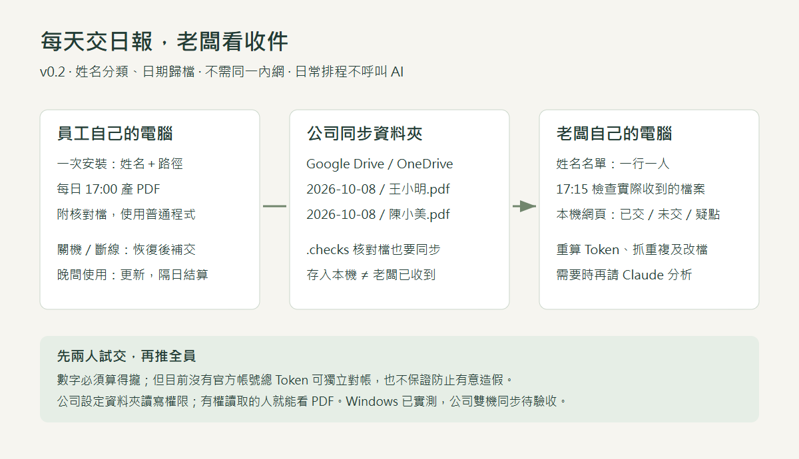
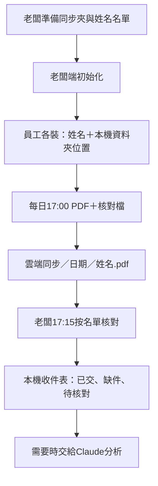

# 給老闆的六步落地說明

**公司同步資料夾＋姓名名單。** 不固定四人，增加員工就是多一行，再替那台電腦安裝一次。

1. **準備收件位置**：沿用公司Google Drive／OneDrive，同步到每台電腦，不需同一內網。程式認本機路徑，不是網頁網址；不代建雲端服務。
2. **老闆先裝**：把專案網址交給有本機權限的Claude，讀boss/CLAUDE_HANDOFF.md，提供路徑和名單，建立收件檢查。
3. **員工各裝**：提供姓名、自己的同步路徑、公司專案範圍。預設專案名稱，明確開啟才有工作請求片段。同名加部門，不必手編號。
4. **兩人試交**：按立即補交，再在老闆端看見PDF／核對檔和正確數字。驗證共用帳號是否混入彼此工作。
5. **每天自動交**：17點先交當時版，登入及每30分鐘補交，隔日補昨日整日版。同名同日更新，不累加；關機時无法執行。
6. **看收件，再看內容**：老闆本機HTML列每人已交／未交／待核對，需要時請Claude看PDF提建議。缺件先查同步、關機和假勤。

程式唯讀＋指紋是基本防誤改，改MD不影響算法，但電腦主人仍能繞過。數字重算必須完全一致；目前沒有官方帳號總Token獨立對帳來源。

共用夾有讀取權就看得到PDF，不自動員工隔離。核對檔.checks要一併同步。Windows已實測，公司跨電腦仍需試行；新版macOS安裝尚未提供。

舊伺服器／配對圖已不代表此版流程，保留於Git歷史。
