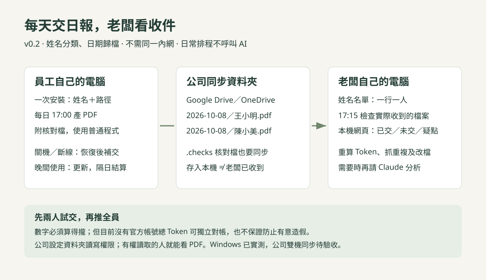

# 給老闆的架構與導入說明

2026-10-08｜依 v0.1.0 程式核對。此文件是導入規劃，不表示已在公司部署。

## 誰能看？

看板是管理端。未登入的人能開登入頁，但無法讀報表；持有管理金鑰的人可看全體資料、配對和撤銷裝置。員工配對憑證只有自己裝置的上傳權限，不能看別人的資料，也沒有員工自助查詢頁。

目前是單一管理金鑰，並沒有多位主管的獨立登入與分部門權限。因此「只有老闆能看」的前提是管理金鑰只交給老闆；不能將它當成員工配對檔發出去。公開GitHub並不會公開公司報表。

之前展示的是合成資料的示範截圖，並不是已經部署好的公司監控站。

## 人數與分類

A、B、C、D只是範例；程式沒有四人上限。每增加一台，就由老闆新增一筆配對。實際承載人數尚未做壓力測試，不能宣稱無限擴充。

現有版的識別鏈：**老闆指定的名稱 → 系統生成的裝置編號 → 該裝置獨有的配對憑證**。不是從共用Codex帳號猜員工姓名，也不讓員工自行填名字冒充別人。

建議統一命名如下（全為示例）：

| 看板名稱 | 代表什麼 |
|---|---|
| E001｜員工甲｜公司筆電 | 員工甲的一台電腦 |
| E002｜員工乙｜公司桌機 | 員工乙的一台電腦 |
| E002｜員工乙｜外出筆電 | 同一員工的另一台，要用不同配對檔 |
| E003｜員工丙｜公司筆電 | 新人直接新增，不改程式 |

**上述 E001 是目前名稱的命名規則，不是已存在的獨立員工欄位。**目前一人兩台會顯示兩筆，沒有按人自動合併，也沒有部門篩選。

若公司有一人多機或部門管理需求，正式版應補：公司 → 員工名冊（固定員工編號、姓名、部門、在職狀態）→ 多台裝置（各自配對／撤銷）。換機時歸到同一人；新人獨立建檔，不沿用離職者憑證。此員工層屬建議規劃，尚未實作。

## 安裝順序

1. **先確認公司環境**：實際員工數、Windows或Mac、每人幾台電腦、是否都在同一網路、是否需要工作片段。這些決定部署與驗收範圍。
2. **老闆先架接收站**：由老闆的Claude依SETUP.md，選定持續運作的公司電腦或主機，建立老闆可登入、員工可連線的網址。跨網路需要HTTPS入口。GitHub網址只負責下載，不會替公司提供資料庫與接收站。
3. **老闆逐台配對**：輸入員工／裝置名稱，下載專屬配對檔。它含接收站網址與該台上傳憑證，私下交付對應員工。管理金鑰不下發。
4. **員工安裝**：把GitHub網址＋自己的配對檔給具有本機操作權限的Codex或Claude。安裝器建立一般程式背景排程；預設只傳專案名稱，可限公司專案。要看最多180字的使用者請求片段，另行明確開啟。
5. **兩台先試，再擴大**：A做工作、B不動；交換測一次，再測離線補傳、重開機／登入與撤銷。確認不會把同步紀錄錯算給別人，才逐台擴大安裝。

只有一般Claude網頁聊天、沒有本機檔案與終端權限時，不能直接代裝；需由具備工具權限的AI或人操作。Python、PowerShell、公司防火牆與系統權限也可能需要安裝者處理，不能承諾每台只貼一句話就一定零操作完成。

## 平常怎麼跑

員工照常使用Codex → 本機留下可解析的使用紀錄 → 程式每5分鐘只處理新增部分 → 私有接收站驗證配對並去重 → 老闆開網頁查詢。

老闆要建議時：匯出日報 → 交給Claude → Claude解讀並提出需核實的問題。這一步目前由老闆發起，沒有自動把報表送進Claude。

收集、傳輸、統計、網頁刷新均不呼叫模型。主動請Claude分析才用Claude額度；主機和網路若採付費服務，另有其成本。電腦關機／睡眠時不能即時上傳，恢復後補傳仍保留的紀錄。

## 能否正式交付？

| 階段 | 現況／交付條件 |
|---|---|
| 程式與文件 | v0.1.0已公開；20項本機測試、Windows合成資料真排程、桌機／手機主要流程通過 |
| 公司接收主機與網址 | 尚未替朋友部署；須驗證HTTPS、網路可達、持續運作及備份 |
| 員工分類 | 已有裝置配對；按人合併、員工名冊、部門篩選尚未實作 |
| 共用帳號歸屬 | 必須以兩台實體電腦驗收；本機有紀錄不代表本人發起工作 |
| Mac安裝 | 已提供腳本，尚未實機驗證 |
| 資料分享 | 須確認公司專案範圍、是否分享工作原文片段、保存期限與管理金鑰保管人 |

最重要的通過條件：能辨識每台、計數對得上、同步不混帳、斷線能補傳、停止／撤銷有效，且老闆真的看得到所需工作線索。若共用帳號無法穩定區分發起裝置，應改用獨立帳號或有可核對身分的來源，不能靠表格命名解決。

建議對朋友的說法：**「我做好一套可試行的工具，先幫你架老闆端，再挑兩台員工電腦驗證；驗證通過才全員安裝。」**

相關文件：[員工安裝](../employee/INSTALL.md) · [Claude交接](../boss/CLAUDE_HANDOFF.md) · [驗收清單](ACCEPTANCE.md) · [量測限制](MEASUREMENT.md)
